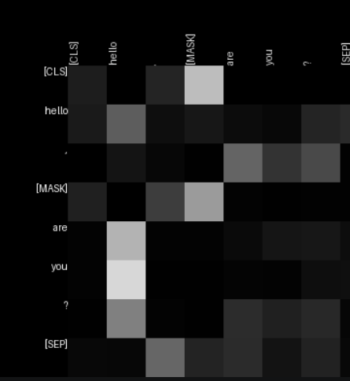

# Visualisation de l'attention avec BERT

Ce projet utilise le modèle de langage BERT `bert-base-uncased` pour compléter un mot masqué dans une phrase et visualiser les poids d'attention du modèle.

## Fonctionnement

Le script `mask.py` :

1. demande une phrase contenant le marqueur `[MASK]` ;
2. affiche les trois propositions les plus probables pour remplacer ce marqueur ;
3. génère une carte d'attention pour chaque tête de chaque couche du modèle.

Sur les cartes, les tokens sont affichés sur les axes. Chaque cellule représente le poids d'attention entre deux tokens : une teinte plus claire indique un poids plus élevé.

## Prérequis

- Python
- Les dépendances listées dans `requirements.txt`
- Une connexion Internet lors de la première exécution pour télécharger le tokenizer et le modèle BERT

## Installation

Depuis le dossier du projet :

```bash
python -m pip install -r requirements.txt
```

Le fichier `requirements.txt` installe TensorFlow, Transformers et Pillow. Le script peut également utiliser PyTorch si celui-ci est installé et qu'aucun backend TensorFlow compatible n'est disponible.

## Utilisation

Lancer le script depuis ce dossier :

```bash
python mask.py
```

Le texte saisi doit être en anglais et contenir le marqueur `[MASK]`, par exemple :

```text
The capital of France is [MASK].
```

Le script affiche ensuite les trois phrases proposées dans le terminal.

### Pourquoi faut-il saisir le texte en anglais ?

Le script charge le modèle pré-entraîné `bert-base-uncased`, qui a été entraîné principalement sur des textes en anglais. Son vocabulaire et ses prédictions sont donc adaptés à l'anglais ; avec une phrase en français, les propositions risquent d'être moins pertinentes ou de ne pas correspondre aux mots attendus. Pour traiter correctement du français, il faudrait utiliser un modèle multilingue ou un modèle entraîné pour le français, ainsi que son tokenizer associé.

## Cartes d'attention

Les images PNG sont enregistrées dans le dossier `attention_maps`, situé à côté de `mask.py`. Ce dossier est créé automatiquement lors de la génération des cartes.

Les fichiers suivent le format `Attention_Layer{numéro}_Head{numéro}.png`, par exemple :

```text
attention_maps/
├── Attention_Layer1_Head1.png
├── Attention_Layer1_Head2.png
└── ...
```

Les numéros de couche et de tête commencent à 1. Une nouvelle exécution remplace les images portant les mêmes noms.

### Exemple de carte d'attention



Chaque ligne et chaque colonne correspondent à un token de la phrase. Une ligne montre comment le modèle répartit son attention depuis le token correspondant vers les autres tokens, représentés en colonnes. Les cases claires indiquent un poids d'attention plus élevé ; les cases sombres, un poids plus faible. Les tokens spéciaux comme `[CLS]`, `[MASK]` et `[SEP]` font également partie de la représentation.

Cette image montre une seule tête d'attention d'une couche du modèle. Chaque couche et chaque tête peuvent apprendre des relations différentes entre les tokens : une carte illustre donc une partie du fonctionnement de BERT, et non à elle seule une explication complète de sa prédiction.

## Structure du projet

- `mask.py` : chargement du modèle, complétion du texte et génération des cartes.
- `requirements.txt` : dépendances Python.
- `assets/fonts/` : police utilisée pour annoter les images (une police par défaut est utilisée si elle n'est pas trouvée).
- `assets/images/carte-attention-exemple.png` : image d'exemple affichée dans ce README.
- `attention_maps/` : cartes générées ; créé automatiquement à la première génération.
